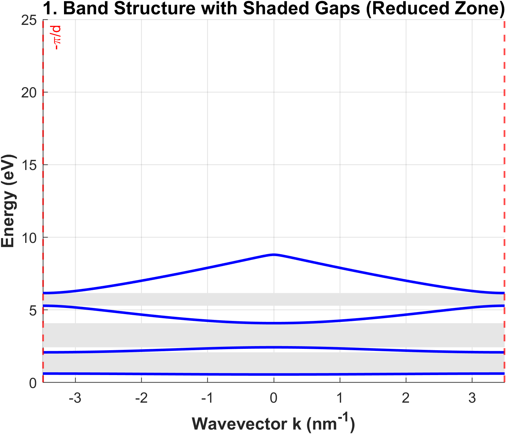
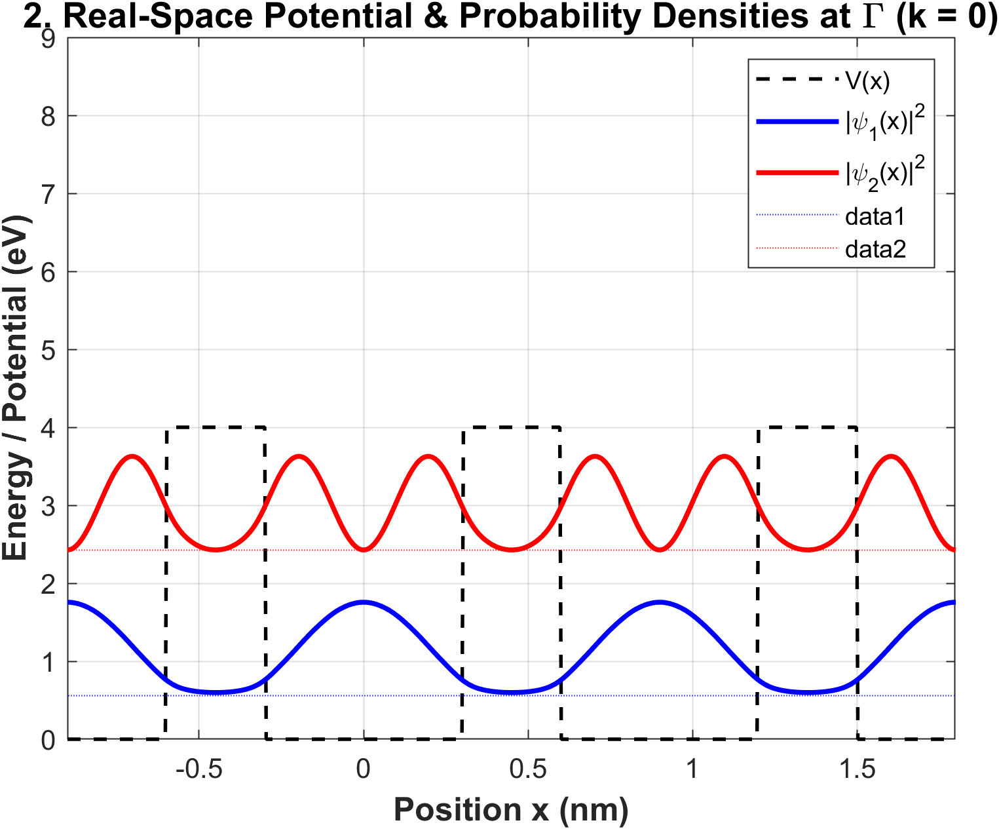
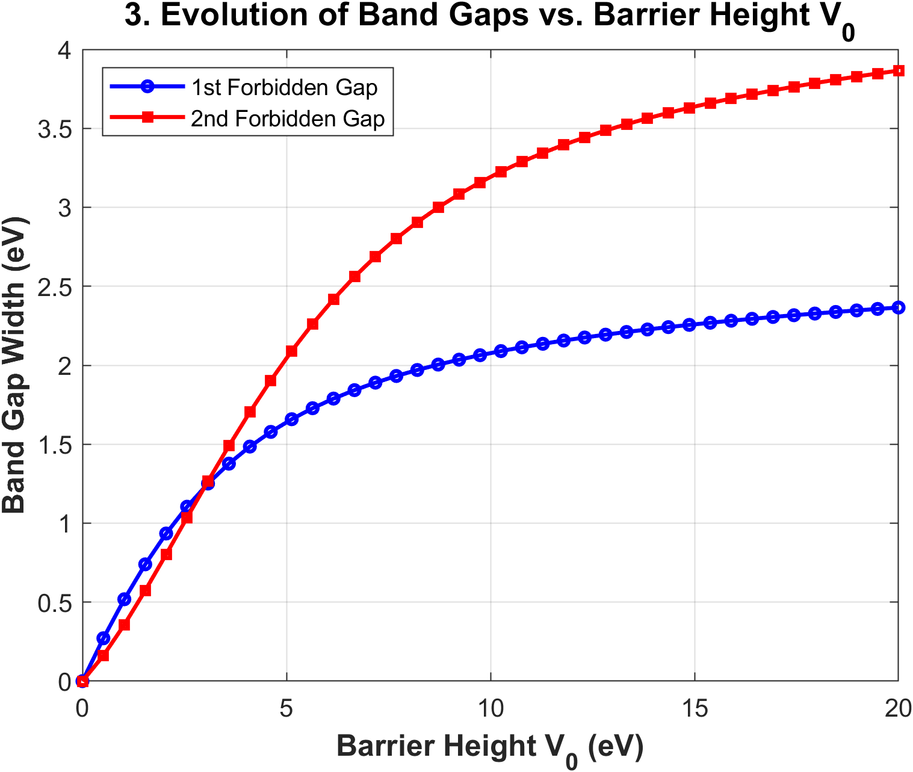

# Kronig_penny_PWEM_1D.m

Solves the 1D Kronig-Penney model using the **Plane Wave Expansion Method (PWEM)** for a periodic rectangular potential consisting of two quantum wells separated by a barrier (Well₁ – Barrier – Well₂).

---

## Parameters

| Parameter | Symbol | Value |
|-----------|--------|-------|
| Well-1 width | `w1` | 0.3 nm |
| Barrier width | `b` | 0.3 nm |
| Well-2 width | `w2` | 0.3 nm |
| Lattice constant | `d = w1 + b + w2` | 0.9 nm |
| Barrier height | `V0` | 4 eV |
| Kinetic prefactor | `hm = ℏ²/2mₑ` | 0.0381 eV·nm² |
| Plane wave cutoff | `N` | 10 → basis size M = 21 |
| k-points | `Mk = 10 × M` | 210 |

---

## Method

1. Constructs the $(2N+1) \times (2N+1)$ Fourier potential matrix $V_{mn}$ analytically from the rectangular barrier profile.
2. Builds the Hamiltonian $H = KE + V$ at each k-point across $[-\pi/d,\ +\pi/d]$, enforces Hermiticity, and diagonalises to obtain eigenvalues and eigenvectors.
3. Reconstructs the real-space Bloch wavefunctions $\psi_n(x)$ from the PWEM eigenvectors via the Fourier sum.
4. Runs two parametric sweeps:
   - **Gap vs. V₀**: solves the Hamiltonian at $k=0$ and $k=\pi/d$ for 40 values of $V_0 \in [0, 20]$ eV.
   - **Bandwidth vs. b**: solves at $k=0$ and $k=\pi/d$ for 30 values of $b \in [0.05, 0.6]$ nm.
   - **PWEM convergence vs. N**: solves at $k=0$ for $N = 1 \ldots 30$ and tracks $E_1$ and $E_2$.

---

## Outputs

### Figure 1 — Band Structure with Shaded Forbidden Gaps
Plots the first 4 energy bands $E_n(k)$ across $[-\pi/d,\ +\pi/d]$ (Reduced Zone Scheme) with forbidden band gaps shaded and zone boundaries at $\pm\pi/d$ marked.

### Figure 2 — Real-Space Potential & Bloch Probability Densities at Γ (k = 0)
Plots the periodic potential profile $V(x)$ over 3 unit cells overlaid with the reconstructed probability densities $|\psi_1(x)|^2$ and $|\psi_2(x)|^2$ offset to their energy levels $E_1$ and $E_2$.

### Figure 3 — Band Gaps vs. Barrier Height V₀
Plots the evolution of the 1st and 2nd forbidden band gaps as a function of $V_0 \in [0, 20]$ eV.

