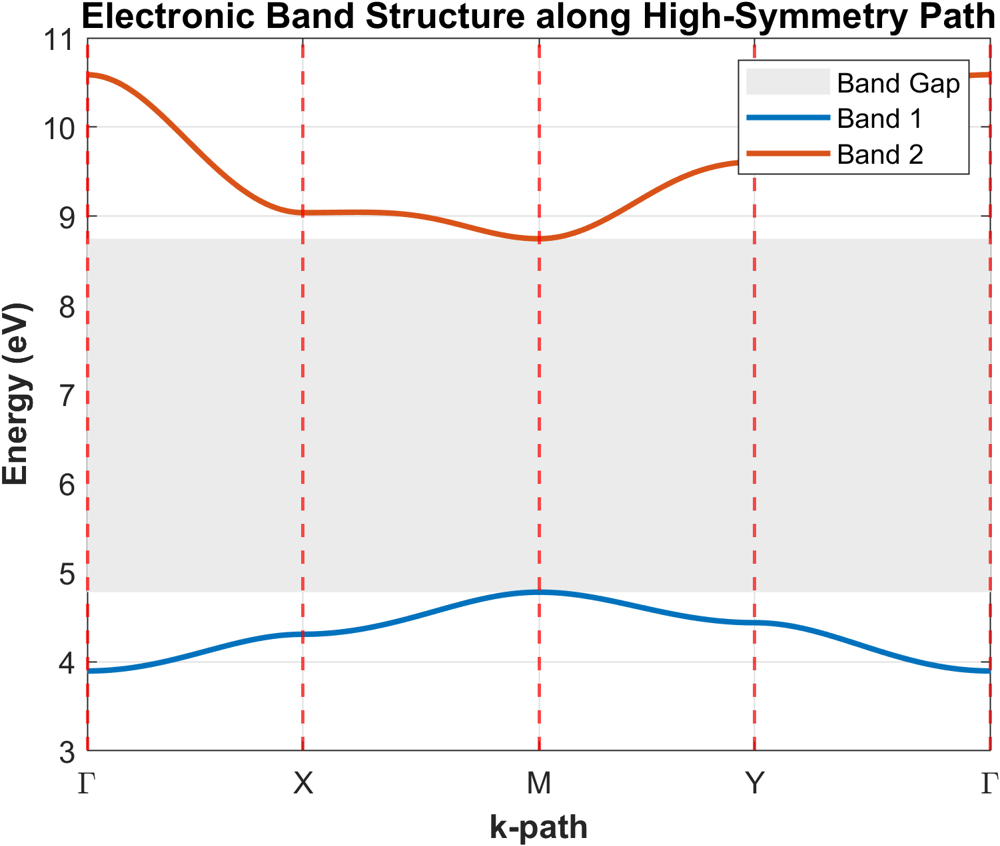
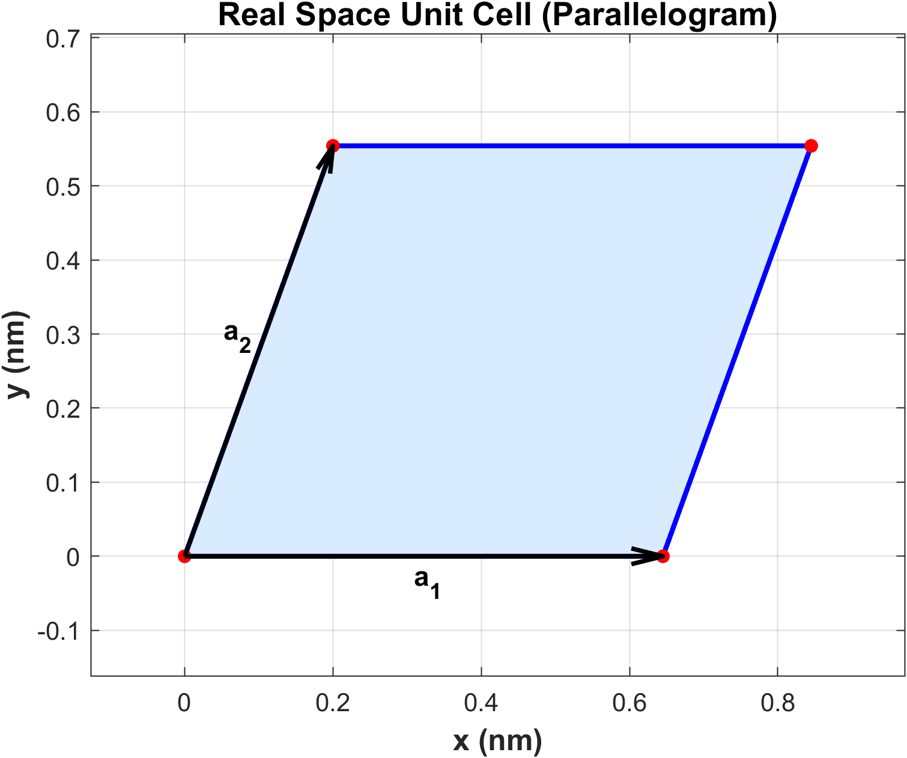
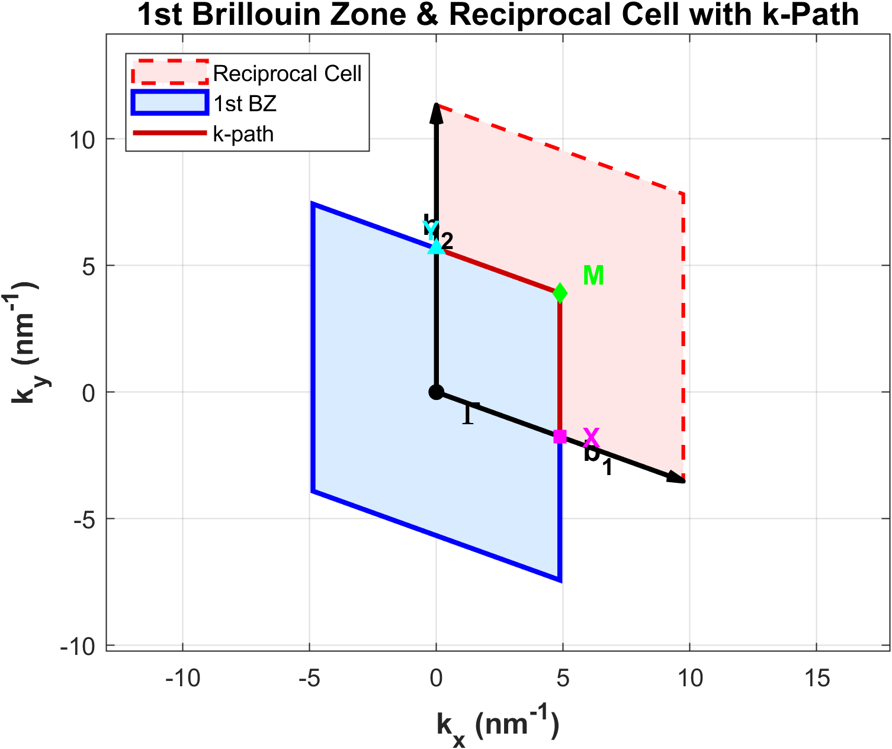
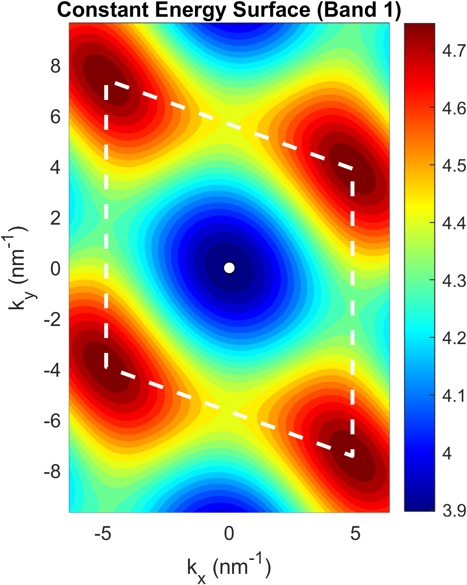
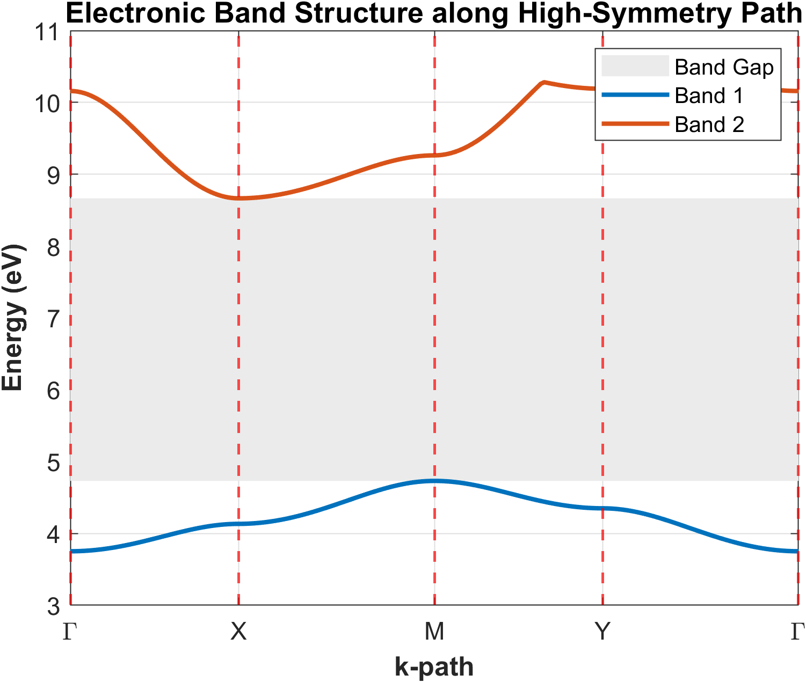
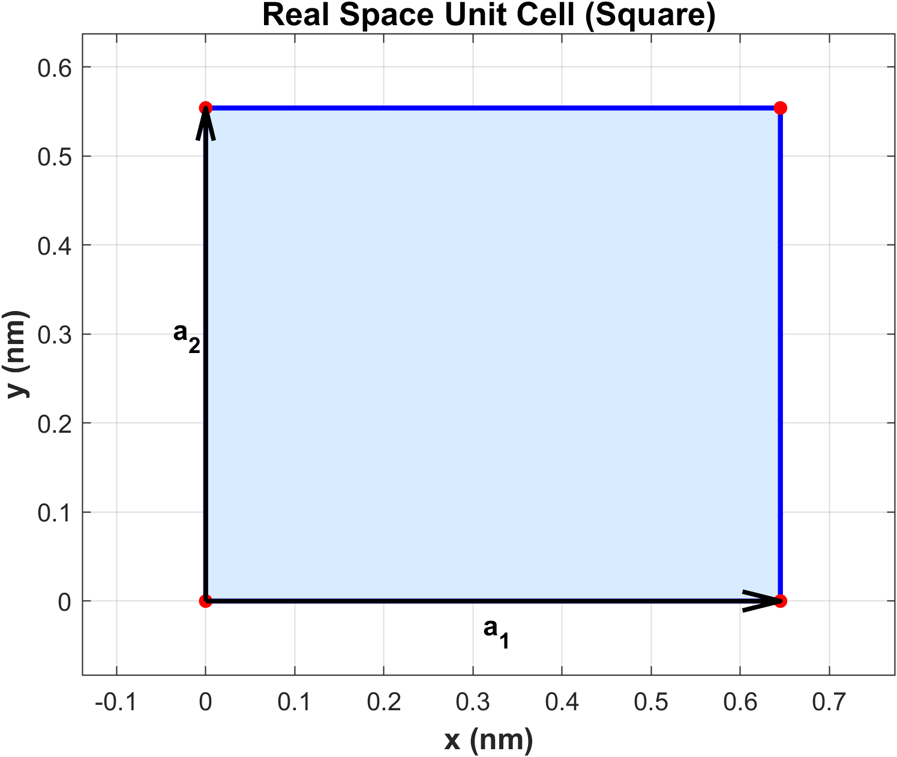
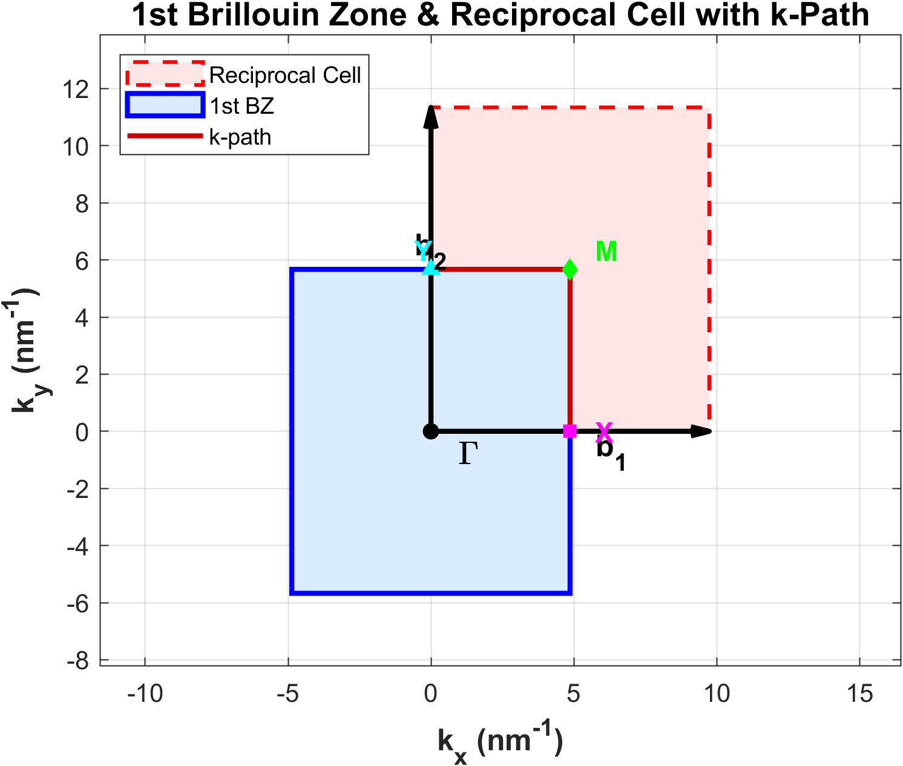
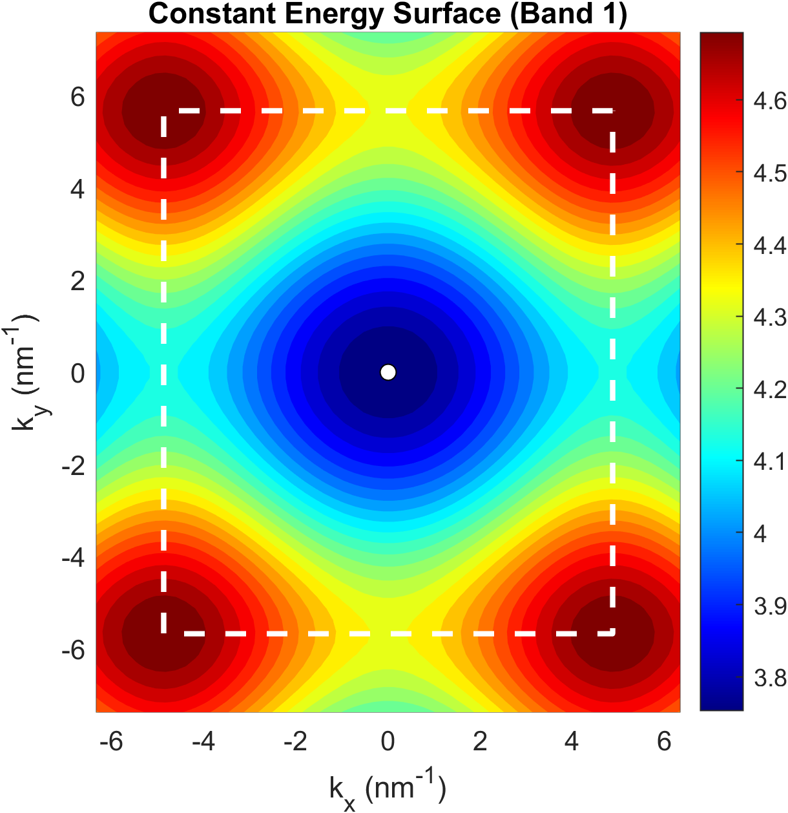

# Oblique_Lattice_PWEM_2D.m

Computes the **2D electronic band structure** using the **2D Plane Wave Expansion Method (PWEM)**. The code supports both:
- **General Oblique (Parallelogram) Lattice** (`a ≠ 0`, default: $a = 0.200\text{ nm}$, $l = 0.645\text{ nm}$, $h = 0.554\text{ nm}$)
- **Square / Rectangular Lattice** (`a = 0`, where the unit cell and reciprocal lattice reduce to orthogonal symmetry)

---

## Parameters

| Parameter | Symbol | Oblique Case | Square Case |
|-----------|--------|--------------|-------------|
| Horizontal length | `l` | 0.645 nm | 0.645 nm |
| Lateral shift | `a` | 0.200 nm | 0.000 nm |
| Cell height | `h` | 0.554 nm | 0.645 nm |
| Barrier height | `V0` | 2.0 eV | 2.0 eV |
| Effective mass prefactor | `hm = ℏ²/2m*` | 0.0847 eV·nm² | 0.0847 eV·nm² |
| Plane wave cutoff | `N` | 10 ($N_{pw} = 441$) | 10 ($N_{pw} = 441$) |
| k-segment interpolation | `N_interp` | 50 points | 50 points |
| CES grid resolution | `Nk_2d` | 60 × 60 | 60 × 60 |

---

## Method

1. Constructs 2D reciprocal lattice vectors $\mathbf{b}_1, \mathbf{b}_2$ from the geometry.
2. Generates the $(2N+1)^2 = 441$ plane wave basis $\{\mathbf{G}_{m_1,m_2}\}$.
3. Builds the $N_{pw} \times N_{pw}$ Fourier potential matrix $V$ analytically.
4. Linearly interpolates the high-symmetry path $\Gamma \to X \to M \to Y \to \Gamma$.
5. Diagonalizes $H = KE + V$ at each k-point to extract band dispersion.
6. Computes the Constant Energy Surface (CES) across the 2D reciprocal space on a uniform $60 \times 60$ grid.

---

## Outputs — Oblique (Parallelogram) Lattice (`a = 0.200 nm`)

### Figure 1 — Electronic Band Structure
Band dispersion along $\Gamma \to X \to M \to Y \to \Gamma$ with shaded forbidden gap.

### Figure 2 — Real-Space Unit Cell (Parallelogram)
Real-space unit cell polygon with primitive translation vectors $\mathbf{a}_1$ and $\mathbf{a}_2$.

### Figure 3 — 1st Brillouin Zone & Reciprocal Cell with k-Path
1st Brillouin Zone polygon, reciprocal unit cell, basis vectors $\mathbf{b}_1, \mathbf{b}_2$, and the complete $\Gamma \to X \to M \to Y \to \Gamma$ path.

### Figure 4 — Constant Energy Surface (CES)
2D energy contours of Band 1 overlaid with the 1st Brillouin Zone boundary and high-symmetry points.

---

## Outputs — Square Lattice Case (`a = 0`)

When $a = 0$, the lattice reduces to an orthogonal square symmetry. The generated outputs are stored in `Square_Lattice_PWEM_2D/`:

### Figure 1 — Electronic Band Structure (Square)
Degeneracies and symmetric dispersion along $\Gamma \to X \to M \to Y \to \Gamma$.

### Figure 2 — Real-Space Unit Cell (Square)
Orthogonal square primitive cell with perpendicular lattice vectors.

### Figure 3 — 1st Brillouin Zone & Reciprocal Cell (Square)
Square Brillouin zone aligned with reciprocal axes.

### Figure 4 — Constant Energy Surface (Square)
Highly symmetric 4-fold isotropic energy contours of Band 1.

