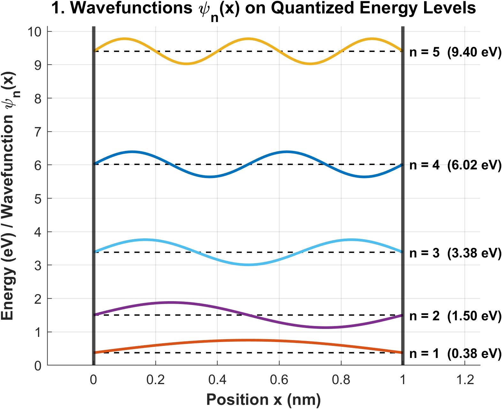
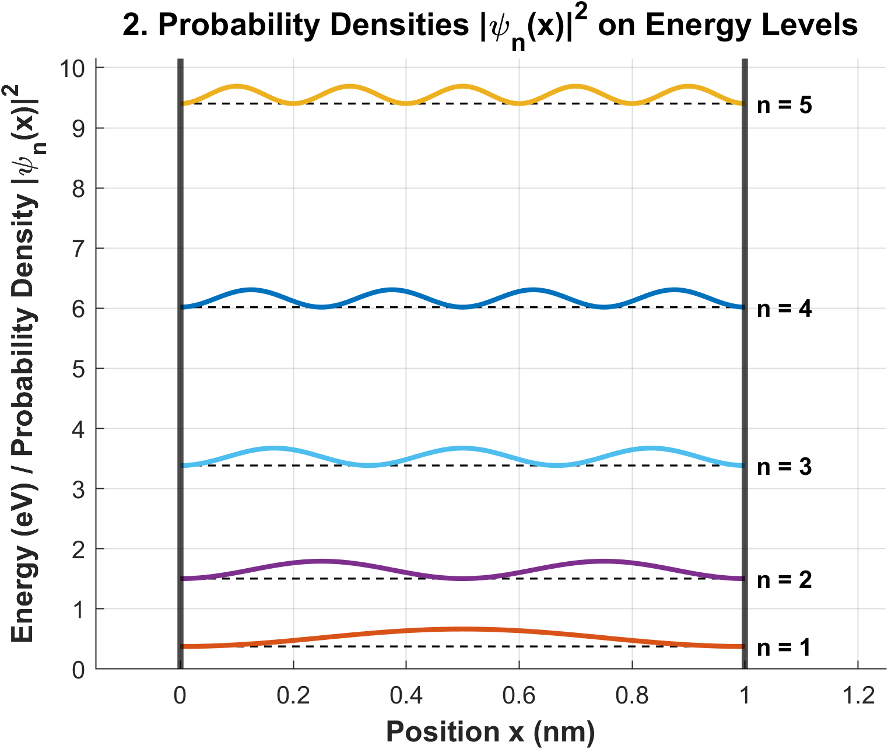
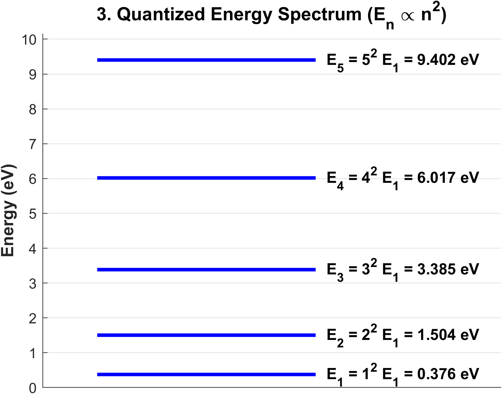
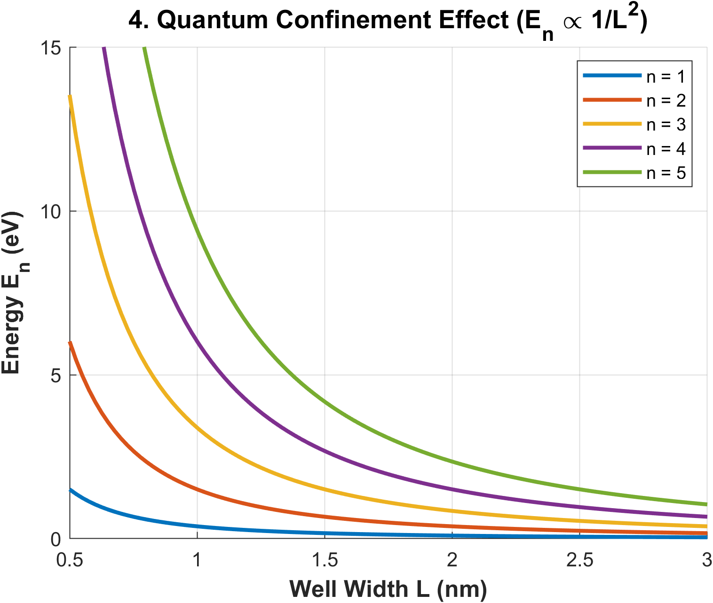
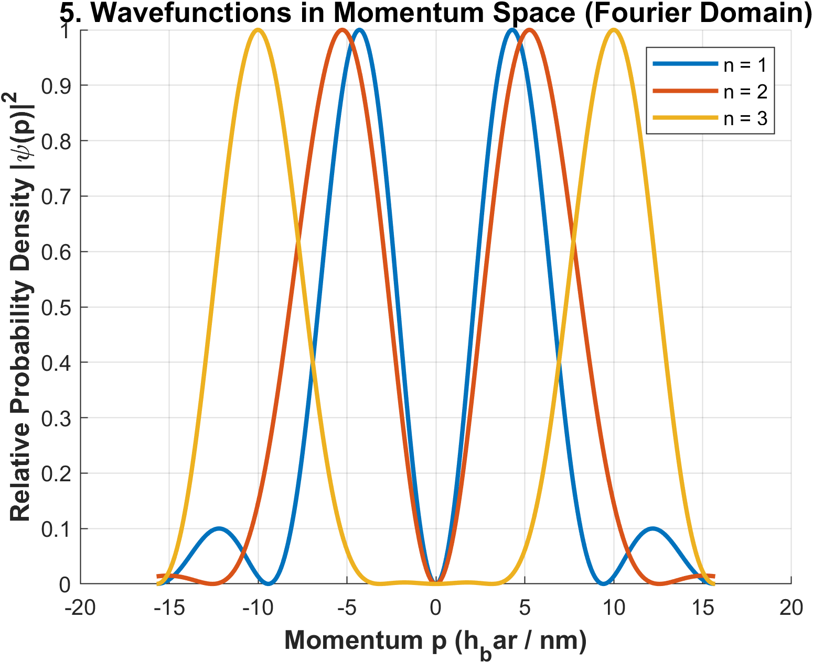

# Schrodinger_Laplace_infinite_well.m

Solves the 1D Time-Independent Schrödinger Equation for an **infinite potential well (particle in a box)** using the **Laplace Transform method** symbolically via MATLAB's Symbolic Toolbox, then evaluates all physical quantities numerically from the analytic results.

---

## Parameters

| Parameter | Symbol | Value |
|-----------|--------|-------|
| Well width | `L_val` | 1 nm |
| Planck constant | `hp` | 6.626 × 10⁻³⁴ J·s |
| Electron mass | `me` | 9.109 × 10⁻³¹ kg |
| Elementary charge | `q` | 1.602 × 10⁻¹⁹ C |
| Speed of light | `c_light` | 3 × 10⁸ m/s |
| Number of states | `num_states` | 5 |

---

## Method

**Section 1 — Symbolic Solution:**
1. Sets up the Laplace-transformed ODE: $s^2 \Phi(s) - c_1 + k^2 \Phi(s) = 0$, with initial condition $\psi'(0) = 0$ absorbed.
2. Solves for $\Phi(s) = c_1 / (s^2 + k^2)$ symbolically.
3. Applies the inverse Laplace transform to get $\psi(x) = c_1 \sin(kx) / k$.
4. Applies boundary condition $\psi(L) = 0$ → quantisation $k_n = n\pi/L$.
5. Applies normalisation $\int_0^L \psi^2\,dx = 1$ to solve for $c_1 = \sqrt{2/L}$.
6. Outputs the final analytic wavefunction `Psi_Final` and energy expression `E_analytic`.

**Section 2 — Numerical Evaluation:**
- All energy levels $E_n$ and wavefunction values are computed by direct symbolic substitution into `Psi_Final` and `E_analytic`; no formulas are written manually.
- Figure 4 (confinement sweep) uses the energy formula $E_n = n^2 h^2 / 8m_e L^2$ evaluated numerically across $L \in [0.5, 3]$ nm.
- Figure 5 (momentum space) uses the analytical Fourier transform of the infinite-well box states via `sinc` functions.

---

## Outputs

### Figure 1 — Wavefunctions ψₙ(x) on Energy Levels
Plots $\psi_n(x)$ for $n = 1 \ldots 5$ shifted vertically to sit on their respective energy levels, with the infinite barrier walls drawn at $x = 0$ and $x = L$.

### Figure 2 — Probability Densities |ψₙ(x)|² on Energy Levels
Plots the spatial probability densities $|\psi_n(x)|^2$ shifted onto the quantized energy levels.

### Figure 3 — Quantized Energy Spectrum
Displays the discrete energy levels $E_n = n^2 E_1$ on an energy ladder diagram.

### Figure 4 — Quantum Confinement: Eₙ vs. Well Width L
Sweeps $L \in [0.5, 3]$ nm to illustrate the quantum confinement effect ($E_n \propto 1/L^2$).

### Figure 5 — Momentum-Space Distribution |ψ(p)|²
Plots the analytical Fourier transform (momentum-space representation) of the spatial states for $n = 1, 2, 3$ in units of $\hbar/\text{nm}$.

